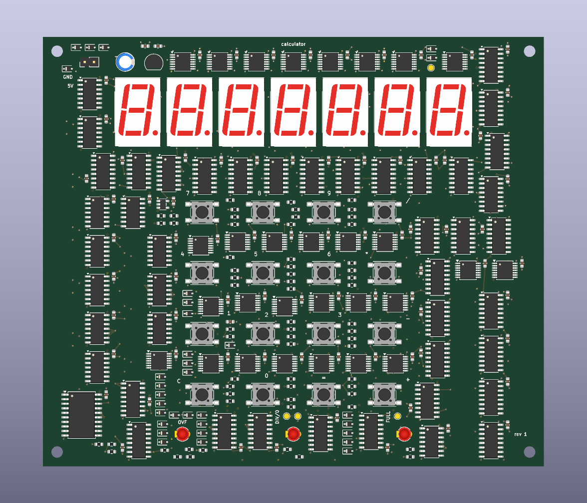
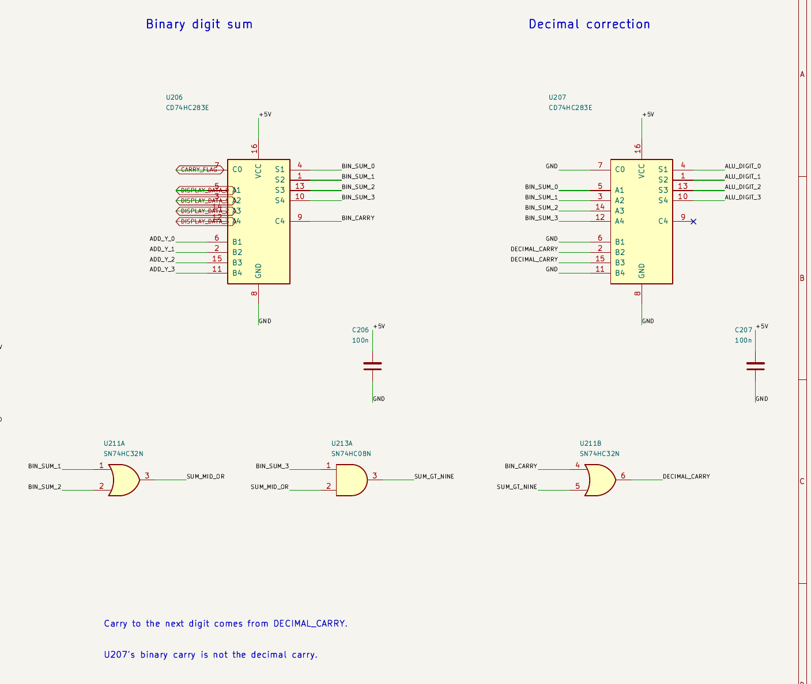

# Calculator

a calculator built from logic chips. there is no microcontroller or firmware.

it takes whole numbers from 0 to 9999 and does addition, subtraction, multiplication and division. it shows negative results, rounds division to two decimal places, and has lights for overflow, divide by zero and a full input.

three registers hold the numbers. a shared decimal adder works through them one digit at a time. the controller runs the loops for multiplication and long division.

this is now a PCB build. the board has a keypad and display on the front, with surface mount logic on both sides. the new sheets handle the buttons, display drivers, clock and power-on reset.

open [calculator.kicad_pro](calculator.kicad_pro) in KiCad 10. the [build notes](BUILD.md) have the board status and parts list. progress from the breadboard design is in [JOURNAL.md](JOURNAL.md).

made for Hack Club Half Life, week 5
